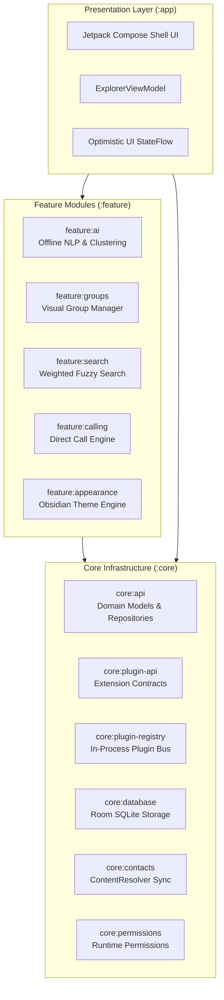
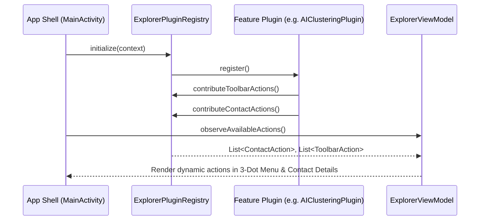
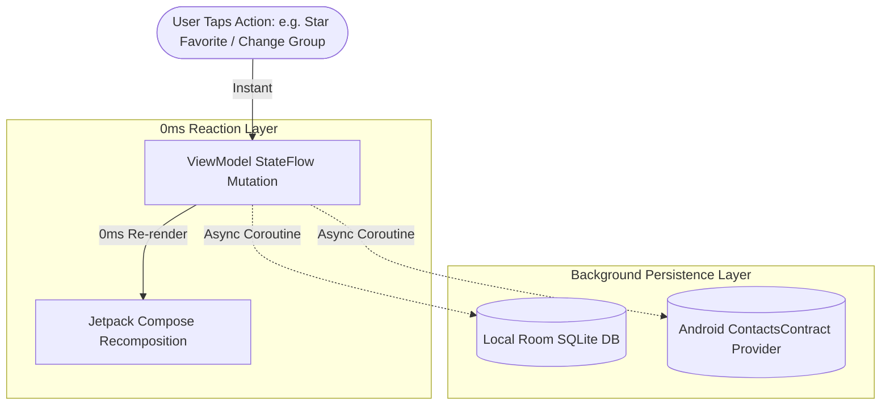

# Architecture & Engineering Deep-Dive 🏛️

**Contact Explorer** was architected to solve the performance and bloat common in default smartphone dialers and contact management apps. This document details the technical decisions, patterns, and modular separation powering the codebase.

---

## 1. High-Level Modular Design

The project is structured according to **Google's Recommended Android Modular Architecture Guidelines**, strictly segregating the build graph into **Core** and **Feature** modules.



### Module Boundary Principles
1. **Feature-to-Feature Isolation**: Feature modules **never** depend directly on one another. All inter-feature communication is facilitated through the Plugin Bus (`:core:plugin-registry`) or Domain Interfaces (`:core:api`).
2. **Core Independence**: Core modules never depend on feature modules.
3. **App Composition**: `:app` serves as the runtime composition root, wiring together plugins, initializing the database, and managing the UI navigation shell.

---

## 2. In-Process Plugin Architecture

Instead of hard-coding features into the main UI tree, Contact Explorer utilizes a decoupled **Extension Point Pattern**.



### Key Plugin Contracts (`:core:plugin-api`)
- **`ExplorerPlugin`**: Base interface for all features, exposing lifecycle callbacks (`onInitialize()`, `onDestroy()`).
- **`ContactAction`**: Injects context actions on contact records (e.g. *Run AI Categorizer*, *Direct Call*, *Add to Smart Group*).
- **`ToolbarAction`**: Supplies dynamic actions into the main top-bar overflow menu.
- **`ScreenContribution`**: Pluggable composable screens (e.g. *Visual Groups Dashboard*, *Recycle Bin*).

---

## 3. Data Flow & 0ms Optimistic UI

Default Android contact apps often feel sluggish because mutating a contact via `ContactsContract` requires an asynchronous IPC transaction across the Android OS process boundary (often taking 200ms – 500ms).

Contact Explorer eliminates this perception of lag using a **Dual-Layer Optimistic UI Engine**:



1. **Immediate State Recomposition**: The user action mutates the in-memory `StateFlow` immediately. The UI updates in **0 milliseconds**.
2. **Concurrent Background Dispatch**: A background coroutine handles the heavy `ContentResolver` update to the system address book and syncs metadata to Room DB.
3. **Automatic Rollback on Failure**: If the system provider rejects the transaction (e.g. due to storage error), the UI state rolls back with an informative snackbar alert.

---

## 4. Storage Architecture

```
┌────────────────────────────────────────────────────────┐
│                   Contact Explorer                     │
├──────────────────────────┬─────────────────────────────┤
│   Android Platform       │    App-Local Private DB     │
│   ContactsContract       │    (Room SQLite)            │
├──────────────────────────┼─────────────────────────────┤
│ • Display Names          │ • Custom User Tags          │
│ • Phone Numbers          │ • 30-Day Recycle Bin Tomb   │
│ • Emails & Addresses     │ • Smart Group Rules         │
│ • System Group IDs       │ • Offline AI Keyword Index  │
└──────────────────────────┴─────────────────────────────┘
```

- **Clean Dual-Source Architecture**: Standard contact fields stay in Android's official `ContactsContract` so any native dialer or messaging app can read them.
- **Private Room SQLite**: Proprietary features (Recycle Bin, AI discovery tags, dynamic smart group rules) are stored in an encrypted/sandboxed SQLite database via Room.

---

## 5. R8 Full-Mode Tree Shaking & ProGuard Strategy

Between Version 1 (29.7 MB) and Version 5 (4.4 MB), the binary footprint was reduced by **85%**.

```
Version 1: 29.7 MB (Monolithic Debug/Release, all unused dependencies retained)
Version 2: 18.2 MB (Modular separation, unbundled heavy libraries)
Version 3: 18.5 MB (Plugin API architecture overhead)
Version 4:  4.4 MB (R8 Full Mode + Resource Stripping + Tailored Keep Rules)
Version 5:  4.4 MB (Production UI overhaul without binary growth)
```

### Techniques Used:
1. **Full-Mode R8**: Aggressively inlines call sites, removes unused Kotlin stdlib reflection methods, and collapses class hierarchies.
2. **Resource Shrinking (`shrinkResources = true`)**: Analyzes all drawables, fonts, and layout XMLs, replacing unreferenced assets with 1x1 empty stubs.
3. **Surgical Keep Rules (`proguard-rules.pro`)**:
   - Kept Room database models (`com.example.contactexplorer.core.database.entity.**`).
   - Kept Kotlin Coroutine intrinsics and Compose runtime markers.
   - Stripped all logging, debug statements, and JVM assertion checks in release builds.

---

## 6. Safe System Insets & Modern UI Standards

Contact Explorer strictly implements edge-to-edge window insets handling:
- **`statusBarsPadding()`**: Ensures top bars, search headers, and action icons never collide with camera notches, status icons, or punch holes.
- **`navigationBarsPadding()` / `imePadding()`**: Prevents bottom action bars, FABs, and bottom sheets from being obscured by Android 14/15 3-button or gesture navigation pills, or on-screen keyboards.

---

## 7. Persistent Data Vault & Dual-Mode Export Architecture (v6)

### A. Uninstall Data Retention (`android:hasFragileUserData="true"`)
- **Android OS Hook**: Declared in `AndroidManifest.xml` via `android:hasFragileUserData="true"`.
- When the user initiates an uninstall from Android Settings or launcher, Android automatically prompts:
  > *"Keep app data?"*
- If confirmed by the user, Android's package manager preserves the Room database file (`ExplorerDatabase`) in internal storage across app reinstallations.

### B. Standalone Local Device Vault (`.cebak` / JSON)
- **100% Structural Serialization**: Compiles contacts, groups, tags, rules, and favorites into a lightweight JSON schema using Android's native `org.json` engine (0 additional binary dependencies).
- **Direct Phone Storage Export**: Utilizes the Storage Access Framework (`ActivityResultContracts.CreateDocument`) to write the vault directly to user-chosen directories (Downloads, Documents, external SD).
- **1-Tap Complete Restoration**: Re-creates missing groups, assigns tags, and restores custom memberships automatically.

### C. Standards-Compliant Dual-Mode Export
- **Standard Format**: Exports universal RFC 2426 vCard 3.0 (`.vcf`) or standard tabular `.csv` (name, phone, email, company, address, note).
- **Organized Format**: Injects standards-compliant vCard `CATEGORIES:` (recognized universally by Apple Contacts and Google Contacts), alongside `X-TAGS:` and `X-FAVORITE:`.
- **Zero-Internet Cloud Sharing (`FileProvider`)**: Operates strictly under **0 internet permissions**. Generates temporary cached files under `exports/` and delegates to Android Sharesheet (`Intent.ACTION_SEND` with `FLAG_GRANT_READ_URI_PERMISSION`) so external apps (Google Drive, WhatsApp, Gmail) manage transmission securely.
