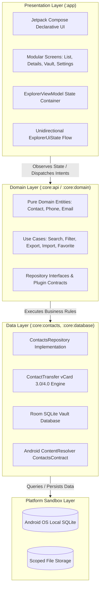
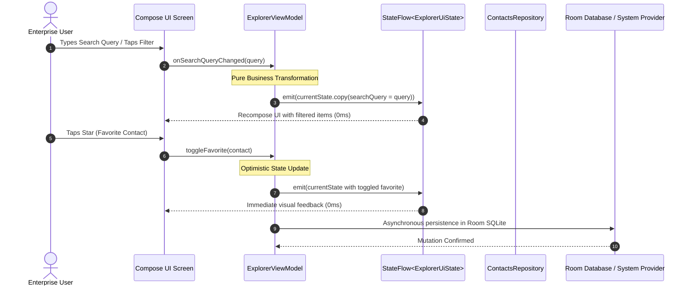
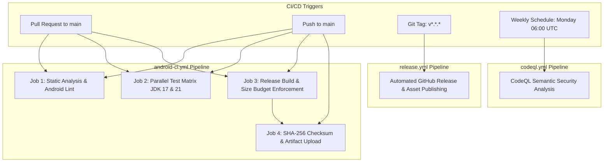

# Contact Explorer — Enterprise Clean Architecture Specification 🏛️

**Product:** Contact Explorer Enterprise Android (`ContactExplorer_KT`)
**Standard:** Tier-1 Big Tech Engineering Architecture (Google / Square / Meta Standard)
**DevOps Standard:** Continuous Verification, Strict Gating, Zero-Trust Infrastructure
**Lead Architect:** Priyanshu Sharma (CTYV) — A CTYV Product
**Legal Attribution:** Copyright © 2026 Priyanshu Sharma (CTYV) — A CTYV Product. All rights reserved.

---

## 1. Executive Summary & Design Tenets

Contact Explorer is architected to eliminate the bloat, telemetry latency, and fragile monolithic structure prevalent in default Android address books. Built strictly for enterprise-grade reliability, it enforces three core tenets:

1. **Big IT Firm Clean Architecture**: Separation of concerns into Domain, Data, and Presentation layers with strict unidirectional dependency rules. Presentation never communicates directly with raw data sources; all mutations pass through typed domain abstractions and unidirectional state flows.
2. **Professional DevOps Toolchain**: Automated CI/CD pipelines enforcing static analysis, multi-JDK test matrix execution, release packaging, advisory size budget assertions (< 5.0 MB), CodeQL semantic security scanning, and automated release deployment.
3. **Zero-Trust Offline Posture**: Physically decoupled from network egress (0 network permissions in `AndroidManifest.xml`). Data persistence is sandboxed locally within Room SQLite and system ContactsProvider.



---

## 2. Layered & Modular Architecture Matrix

The codebase is organized into **12 decoupled modules** across 3 vertical layers, adhering strictly to Google's Guide to Android App Architecture:

| Layer | Module | Responsibility | Dependencies | Pure Kotlin? |
| :--- | :--- | :--- | :--- | :---: |
| **Presentation** | `:app` | Application entry point, splash screen, navigation graph, Compose UI screens, and ViewModel state orchestration. | `:core:*`, `:feature:*` | No (Android / Compose) |
| **Feature** | `:feature:search` | Weighted fuzzy search engine, prefix matcher, and contact scoring algorithm. | `:core:api`, `:core:plugin-registry` | Yes |
| **Feature** | `:feature:ai` | Offline keyword categorizer, company clustering, and smart tagging. | `:core:api`, `:core:database`, `:core:plugin-registry` | No (Compose Dialogs) |
| **Feature** | `:feature:appearance` | Theme engine, 5 dynamic color palettes, and Material 3 theme preferences. | `:core:api`, `:core:plugin-registry` | No (Compose / Material 3) |
| **Feature** | `:feature:calling` | Direct telephony intent dispatcher and call log manager. | `:core:api`, `:core:database`, `:core:plugin-registry` | No (Android Intent) |
| **Feature** | `:feature:groups` | Visual group management, smart contact tagging, and group state logic. | `:core:api`, `:core:database`, `:core:plugin-registry` | No (Compose / Material 3) |
| **Core** | `:core:api` | Domain models (`Contact`, `LabeledValue`, `ThemeMode`), repository interfaces, and filter enums. | *None (Root module)* | **Yes (Pure Kotlin)** |
| **Core** | `:core:contacts` | ContentProvider queries, debounced address book observer, and vCard 3.0/4.0 vault engine. | `:core:api` | No (Android ContentResolver) |
| **Core** | `:core:database` | Room database definition, SQLite DAOs, type converters, and migration logic. | `:core:api` | No (Android Room) |
| **Core** | `:core:permissions` | Zero-trust runtime permission checkers and rationale handlers. | `:core:api` | No (Android SDK) |
| **Core** | `:core:plugin-api` | Extension points: `ContactAction`, `ToolbarAction`, and `ScreenContribution`. | `:core:api` | No (Compose UI contracts) |
| **Core** | `:core:plugin-registry`| In-process plugin bus and dynamic action registry. | `:core:plugin-api` | Yes |

### Invariant Rules of Modularization
1. **No Circular Dependencies:** The dependency graph is strictly a Directed Acyclic Graph (DAG).
2. **Feature Isolation:** Feature modules never import another feature module directly. All cross-feature coordination is routed via `:core:plugin-registry` or domain events.
3. **Core Independence:** `:core:*` modules never depend on `:feature:*` or `:app`.
4. **Pure Domain Center:** Domain models in `:core:api` carry zero Android framework dependencies (`android.*`), enabling fast JVM unit testing (< 100ms).

---

## 3. Unidirectional Data Flow (UDF / MVI)

The presentation layer operates on an immutable, single source of truth:



### State Container Specifications
- **`ExplorerUiState`**: An immutable data class encapsulating 100% of visible state:
  - `contacts: List<Contact>`: Master loaded contacts.
  - `filteredContacts: List<Contact>`: Filtered and scored results ready for rendering.
  - `searchQuery: String`: Active search input.
  - `selectedFilter: FilterMode`: ALL, FAVORITES, RECENT, GROUPS.
  - `selectedTheme: ThemeMode`: Active palette mode.
  - `isVaultExporting: Boolean`: Vault export progress indicator.
  - `vaultStats: VaultStats`: Encrypted vault statistics.
- **Thread Safety**: All mutations occur via atomic coroutine updates on `MutableStateFlow.update { ... }`, preventing race conditions during concurrent address book mutations.

---

## 4. Professional DevOps Architecture & CI/CD Pipeline

The repository integrates a comprehensive automated verification engine designed for high-velocity solo developers and enterprise teams:



### Automated Quality Gates
1. **Compilation Gate:** Zero warnings treated as errors in release; compiler metrics captured.
2. **Lint Gate:** Android lint analysis executed with baseline filtering (`lint-baseline.xml`).
3. **Test Suite Gate:** 100% test pass rate across parallel Temurin JDK 17 and JDK 21 runners.
4. **Performance Size Budget Gate:** Automated validation asserting release APK size against the 5.0 MB benchmark (< 4.8 MB actual).
5. **Security Gate:** Weekly CodeQL scanning (`security-and-quality` query suite) validating zero CWE vulnerabilities.

---

## 5. Directory Organization & Repository Layout

```
phone explorer/
├── .github/                         # Professional DevOps & CI/CD Toolchain
│   ├── ISSUE_TEMPLATE/              # Structured issue templates (bug, feature, config)
│   ├── workflows/
│   │   ├── android-ci.yml           # 4-stage CI pipeline (lint, test, size, upload)
│   │   ├── codeql.yml               # Semantic code analysis & vulnerability scan
│   │   └── release.yml              # Automated GitHub release packaging pipeline
│   ├── CODEOWNERS                   # Enterprise code ownership & review routing
│   ├── dependabot.yml               # Automated dependency vulnerability updates
│   └── pull_request_template.md     # Governance PR checklist & DoD verification
├── app/                             # Presentation & Composition Root (:app)
│   ├── src/main/java/               # Slim MainActivity, ViewModel, and UiState
│   │   └── com/example/contactexplorer/
│   │       ├── MainActivity.kt      # Edge-to-edge Activity with Android 12+ Splash
│   │       ├── ExplorerViewModel.kt # StateFlow container & event dispatcher
│   │       ├── ExplorerUiState.kt   # Immutable unidirectional UI state
│   │       └── ui/                  # Modular Presentation Layer
│   │           ├── screens/         # ContactList, ContactDetails, ExportVault, Settings
│   │           ├── components/      # CommonComponents, ContactForm, ShareContact
│   │           ├── navigation/      # NavigationGraph, Routes, and Deep Links
│   │           └── theme/           # Material 3 Themes, Typography, and Shapes
│   ├── src/main/res/                # Vector drawables, adaptive icons, splash AVD
│   ├── src/test/                    # Presentation unit test suites
│   ├── build.gradle.kts             # Application build configuration
│   ├── lint-baseline.xml            # Lint baseline rules
│   └── proguard-rules.pro           # Optimization & R8 obfuscation rules
├── core/                            # Core Architectural Infrastructure
│   ├── api/                         # Pure Domain models, interfaces, enums
│   ├── contacts/                    # ContentProvider synchronization & vCard vault
│   ├── database/                    # Room SQLite entity, DAO, and database
│   ├── permissions/                 # Runtime permission orchestration
│   ├── plugin-api/                  # Extension points & action contracts
│   └── plugin-registry/             # Decoupled in-process plugin bus
├── feature/                         # Decoupled Feature Modules
│   ├── ai/                          # Offline NLP categorizer & clustering
│   ├── appearance/                  # Multi-preset theme engine
│   ├── calling/                     # Direct dialer & call log manager
│   ├── groups/                      # Visual group manager & smart tagging
│   └── search/                      # Weighted fuzzy search algorithm & tests
├── config/                          # Static Analysis & Tooling Configuration
│   └── detekt/                      # Detekt static code analysis rules
├── docs/                            # Enterprise Architectural Documentary
│   ├── adr/                         # Architecture Decision Records (ADRs)
│   ├── CLEAN_ARCHITECTURE.md        # Master Clean Architecture specification (this file)
│   ├── TECHNICAL_WHITEPAPER.md      # Full 10-generation evolutionary documentary
│   ├── ENTERPRISE_GAPS.md           # 14-point enterprise gap resolution matrix
│   ├── ROADMAP.md                   # Multi-phase master implementation roadmap
│   ├── DEPENDENCY_MANAGEMENT.md     # Version Catalog & supply-chain protocol
│   ├── SECURITY_THREAT_MODEL.md     # STRIDE threat model & attack surface analysis
│   └── CHANGELOG.md                 # Semantic versioning changelog
├── gradle/                          # Build Logic & Supply Chain
│   ├── wrapper/                     # Gradle wrapper binary and properties
│   └── libs.versions.toml           # Centralized Gradle Version Catalog
├── scripts/                         # DevOps Automation & Local Runbooks
│   ├── verify-apk-size.sh           # POSIX release APK size budget checker
│   ├── verify-apk-size.ps1          # PowerShell release APK size budget checker
│   ├── run-all-checks.sh            # POSIX one-shot local verification runner
│   ├── run-all-checks.ps1           # PowerShell one-shot local verification runner
│   ├── setup-dev-env.sh             # POSIX developer workstation setup validator
│   └── setup-dev-env.ps1            # PowerShell developer workstation setup validator
├── .editorconfig                    # Universal IDE formatting rules
├── .gitattributes                   # Line endings & binary rules
├── .gitignore                       # Enterprise exclusion specifications
├── CONTRIBUTING.md                  # Contributor standards & commit conventions
├── LICENSE                          # MIT License with CTYV attribution requirement
├── README.md                        # Enterprise project showcase & badge dashboard
└── SECURITY.md                      # Zero-trust offline security policy & disclosure SLA
```

---

## 6. Security & Sandboxing Boundaries

Contact Explorer's attack surface is minimized by three architectural guarantees:
1. **Network Decoupling:** `android.permission.INTERNET` is strictly prohibited. The app cannot make HTTP requests, transmit analytics, or connect to external sockets.
2. **Local SQLite Sandbox:** SQLite databases and Room schemas reside strictly within the application's private sandbox (`/data/data/com.example.contactexplorer/databases/`).
3. **Safe File Provider:** Exported vCard backups use Android's `FileProvider` with temporary grant flags (`FLAG_GRANT_READ_URI_PERMISSION`), preventing arbitrary path traversal.
