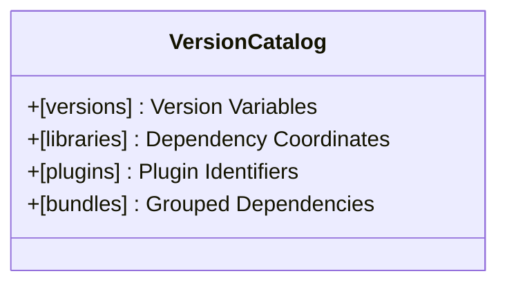

# Modern Android Dependency Management: Gradle Version Catalog (`libs.versions.toml`)

**Project:** Contact Explorer (`ContactExplorer_KT`)
**Standard:** Tier-1 Android Engineering Best Practice (Google Standard)
**Specification Document:** Dependency Governance & Version Catalog Protocol
**Author / Attribution:** Priyanshu Sharma (CTYV) — A CTYV Product

---

## 1. Overview & Problem Statement

In legacy Android repositories, dependencies and plugins are scattered across multiple `build.gradle.kts` files as arbitrary, hardcoded string literals:
```kotlin
// Legacy Bad Practice (Scattered across 12 modules)
implementation("androidx.room:room-runtime:2.8.4")
implementation("androidx.compose.material3:material3")
```

### Why this is an Anti-Pattern:
1. **Version Drift:** Updating Room or Compose in one module while forgetting another causes classpath conflicts and runtime crashes.
2. **Zero Autocomplete / Typos:** String literals are not validated by the IDE or compiler until Gradle sync fails.
3. **Broken Automation:** Tools like Dependabot and Renovate struggle to parse bespoke Kotlin variables or custom `ext` buildscript blocks.

### The Modern Solution: Gradle Version Catalog (`libs.versions.toml`)
Introduced in Gradle 7.0 and made standard in Android Gradle Plugin (AGP) 7.4+, the **Version Catalog** is a single, centralized `TOML` file located at:
```text
<project-root>/gradle/libs.versions.toml
```
Gradle automatically recognizes this location and generates strongly typed, type-safe Kotlin DSL accessors (`libs.*`) across all modules.

---

## 2. Structure & Syntax Rules of `libs.versions.toml`

A Version Catalog is partitioned into four standard tables:



### Rule A: `[versions]` Table
Defines reusable version strings. Use lowercase with hyphens.
```toml
[versions]
agp = "9.0.1"
kotlin = "2.2.10"
compose-plugin = "2.2.10"
ksp = "2.2.10-2.0.2"
compose-bom = "2026.03.01"
room = "2.8.4"
lifecycle = "2.10.0"
core-ktx = "1.18.0"
junit = "4.13.2"
```

### Rule B: `[libraries]` Table
Defines dependencies using `group`, `name`, and either `version.ref` or a direct `version`.
```toml
[libraries]
# Referencing a version from [versions]
androidx-core-ktx = { group = "androidx.core", name = "core-ktx", version.ref = "core-ktx" }
room-runtime = { group = "androidx.room", name = "room-runtime", version.ref = "room" }
room-compiler = { group = "androidx.room", name = "room-compiler", version.ref = "room" }

# Libraries governed by a Bill of Materials (BOM) omit versions
compose-bom = { group = "androidx.compose", name = "compose-bom", version.ref = "compose-bom" }
compose-ui = { group = "androidx.compose.ui", name = "ui" }
compose-material3 = { group = "androidx.compose.material3", name = "material3" }
```

### Rule C: `[plugins]` Table
Defines Gradle plugins with their plugin IDs and version references.
```toml
[plugins]
android-application = { id = "com.android.application", version.ref = "agp" }
android-library = { id = "com.android.library", version.ref = "agp" }
kotlin-compose = { id = "org.jetbrains.kotlin.plugin.compose", version.ref = "compose-plugin" }
ksp = { id = "com.google.devtools.ksp", version.ref = "ksp" }
```

### Rule D: `[bundles]` Table
Groups frequently co-dependent libraries into a single accessor.
```toml
[bundles]
compose = [
    "compose-ui",
    "compose-material3",
    "compose-ui-tooling-preview"
]
room = [
    "room-runtime",
    "room-ktx"
]
```

---

## 3. Name Normalization & Accessor Rules (TOML to Kotlin DSL)

Gradle normalizes names from `libs.versions.toml` into Kotlin DSL accessors using strict conversion rules:

| TOML Identifier (`libs.versions.toml`) | Kotlin DSL Type-Safe Accessor (`build.gradle.kts`) |
| :--- | :--- |
| `androidx-core-ktx` | `libs.androidx.core.ktx` |
| `room.runtime` | `libs.room.runtime` |
| `compose_material3` | `libs.compose.material3` |
| `[plugins] android-application` | `libs.plugins.android.application` |
| `[bundles] compose` | `libs.bundles.compose` |

> [!IMPORTANT]
> **Strict Naming Convention:**
> Always use **kebab-case** (`hyphens-between-words`) in `libs.versions.toml`. Hyphens are converted to sub-accessors (dots) in Kotlin DSL. Avoid mixing dots and underscores in TOML keys to maintain clean IDE auto-completion.

---

## 4. Implementation Guide: Migrating Build Scripts

### Step 1: Root `build.gradle.kts`
Plugins that are used across submodules are declared in the root file with `apply false`:
```kotlin
// Root build.gradle.kts
plugins {
    alias(libs.plugins.android.application) apply false
    alias(libs.plugins.android.library) apply false
    alias(libs.plugins.kotlin.compose) apply false
    alias(libs.plugins.ksp) apply false
}
```

### Step 2: Application Module `app/build.gradle.kts`
```kotlin
plugins {
    alias(libs.plugins.android.application)
    alias(libs.plugins.kotlin.compose)
}

android {
    // ...
}

dependencies {
    // Internal multi-module project references
    implementation(project(":core:api"))
    implementation(project(":core:database"))

    // Version catalog BOM & single dependencies
    implementation(platform(libs.compose.bom))
    implementation(libs.androidx.core.ktx)
    implementation(libs.bundles.compose)

    // Testing
    testImplementation(libs.junit)
}
```

### Step 3: Library Module `core/database/build.gradle.kts`
```kotlin
plugins {
    alias(libs.plugins.android.library)
    alias(libs.plugins.ksp)
}

dependencies {
    api(project(":core:api"))
    implementation(libs.bundles.room)
    ksp(libs.room.compiler)
}
```

---

## 5. Enterprise Governance Rules for Contact Explorer

1. **Zero Hardcoded Strings Policy:** No `build.gradle.kts` file may contain a string literal for dependency coordinates (`"group:name:version"`). A pre-commit hook or CI check should fail if detected.
2. **Centralized BOM Usage:** All Jetpack Compose artifacts MUST defer to `compose-bom` to prevent ABI mismatches across modules.
3. **Automated Dependabot Updates:** GitHub Dependabot must be configured with target `package-ecosystem: "gradle"` to open PRs updating `libs.versions.toml` automatically.
4. **Reproducible Builds:** Dynamic versions (e.g. `2.8.+` or `latest.release`) are strictly forbidden in enterprise production code.

---

## 6. Official Documentation & Reference Links

* **Official Android Guide on Version Catalogs:**
  [Migrate your build to version catalogs](https://developer.android.com/build/migrate-to-catalogs)
* **Gradle Official Documentation:**
  [Sharing dependency versions between projects (Version Catalogs)](https://docs.gradle.org/current/userguide/platforms.html)
* **Google's Reference Architecture (Now in Android):**
  [Google NowInAndroid `gradle/libs.versions.toml`](https://github.com/android/nowinandroid/blob/main/gradle/libs.versions.toml)
* **Jetpack Compose to Kotlin Compatibility Map:**
  [Kotlin Compose Plugin & Compose BOM Compatibility](https://developer.android.com/jetpack/androidx/releases/compose-kotlin)
* **GitHub Dependabot Version Catalog Support:**
  [Dependabot options for Gradle Version Catalogs](https://docs.github.com/en/code-security/dependabot/dependabot-version-updates/configuration-options-for-the-dependabot.yml-file#gradle)
