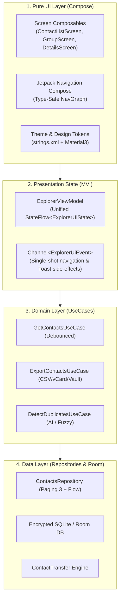

# Enterprise Readiness & Gap Analysis: Contact Explorer (Kotlin/Android)

**Project:** Contact Explorer Android (`ContactExplorer_KT`)
**Audited By:** Independent AI Engineering Partner & Principal Architect
**Attribution:** Priyanshu Sharma (CTYV) — A CTYV Product
**Standard Baseline:** Tier-1 Big Tech / Enterprise Android Engineering Standards (Google, Uber, Cash App)

---

## Executive Summary

Contact Explorer Android features an ambitious 12-module directory layout. However, a deep architectural and code-level scan reveals that **UI/UX and Backend/Data logic are severely entangled**, the multi-module architecture is largely **symbolic (ghost modules)**, and critical reactive state anti-patterns and performance bottlenecks exist across the codebase.

Below is the definitive catalog of all identified gaps, classified by architectural domain, with its exact 1-line impact description.

---

## 1. UI/UX vs. Backend Segregation Breakdown (Core Anti-Pattern)

| # | Problem / Anti-Pattern | 1-Line Description | Severity |
|---|:---|:---|:---:|
| 1.1 | **Monolithic God Activity (`MainActivity.kt` = 2,575 lines)** | Housing 24 `@Composable` functions, business logic, file I/O, dialog mutations, and export workflows in one Activity completely destroys UI/Backend separation. | `CRITICAL` |
| 1.2 | **Direct File I/O & ContentResolver in UI Layer** | `ContactExplorerContent` invokes `context.contentResolver.openInputStream()`, reads raw text streams, and parses JSON files directly inside UI Composables. | `CRITICAL` |
| 1.3 | **Direct `SharedPreferences` Mutation in Presentation** | UI Composables directly instantiate and read `context.getSharedPreferences("explorer_features", Context.MODE_PRIVATE)` instead of consuming an abstracted Settings Repository. | `HIGH` |
| 1.4 | **Toast Popups & Side-Effects inside Composables** | Presentation functions trigger imperative Android `Toast.makeText()` and permission launchers directly in response to asynchronous callback lambdas without a UI event channel. | `MEDIUM` |
| 1.5 | **Data Model Entanglement in Presentation** | Raw Room Entities (`ContactGroup`, `ContactTag`) and Android `ContactsContract` objects are directly rendered in UI without isolated immutable UI models (`UiModel`). | `HIGH` |

---

## 2. Multi-Module Architecture & "Ghost Modules"

| # | Problem / Anti-Pattern | 1-Line Description | Severity |
|---|:---|:---|:---:|
| 2.1 | **False Modularity (Ghost Feature Modules)** | Modules like `:feature:ai` (19 lines), `:feature:appearance` (23 lines), and `:feature:groups` (19 lines) are empty shells whose real logic is actually hardcoded in `:app`. | `CRITICAL` |
| 2.2 | **Misplaced Core Data & Intelligence Logic** | Core business logic like `ContactTransfer.kt` (vCard/JSON engine) and `OfflineIntelligence.kt` (duplicate matching) are dumped into `:app` instead of `:core:contacts` or `:feature:ai`. | `HIGH` |
| 2.3 | **Plugin Registry Decoupling Failure** | The plugin architecture is bypassed in practice because `MainActivity` contains hardcoded `when(section)` switches rather than rendering features dynamically through plugin slots. | `HIGH` |
| 2.4 | **Non-Enterprise Package Naming (`com.example.*`)** | Utilizing the tutorial namespace `com.example.contactexplorer` across all 12 modules signals prototype status and blocks commercial distribution. | `LOW` |

---

## 3. Reactive State Management & Concurrency Anti-Patterns

| # | Problem / Anti-Pattern | 1-Line Description | Severity |
|---|:---|:---|:---:|
| 3.1 | **State Explosion: 35+ Loose `remember { mutableStateOf() }` in One Function** | Managing over 35 disparate mutable state variables in `ContactExplorerContent` leads to unmaintainable state collisions and unpredictable recomposition cycles. | `CRITICAL` |
| 3.2 | **The `revision++` Hack (Fighting Compose Recomposition)** | Incrementing a manual integer counter (`var revision by mutableIntStateOf(0)`) across 10 coroutines to force UI updates demonstrates a broken, non-reactive state model. | `CRITICAL` |
| 3.3 | **Lack of Unified MVI `StateFlow<ExplorerUiState>`** | `ExplorerViewModel` exposes 16 individual mutable Compose properties instead of an immutable, atomic `StateFlow` combining data streams into a single source of truth. | `HIGH` |
| 3.4 | **No Process Death Resilience (Zero `rememberSaveable`)** | UI states, active selection lists, and dialog inputs do not use `rememberSaveable`, causing immediate data loss when the system kills the background process or rotates the screen. | `HIGH` |
| 3.5 | **Async State Inconsistency across 10 Uncoordinated Coroutines** | Spawning 10 uncoordinated `viewModelScope.launch` blocks in `init` collecting database flows causes race conditions and intermediate broken UI renders. | `HIGH` |

---

## 4. Performance, Database & ContentObserver Scaling

| # | Problem / Anti-Pattern | 1-Line Description | Severity |
|---|:---|:---|:---:|
| 4.1 | **Unpaginated Full-Table Queries on Address Book** | `ContactsRepository.loadContacts()` loads the entire device address book and all data rows into memory at once without Paging 3, causing OutOfMemory crashes on large contacts (>2,000). | `CRITICAL` |
| 4.2 | **Missing ContentObserver Debouncing** | `observeContactsChanges()` emits on every individual contact row change without a debounce window, causing catastrophic query storms during bulk contact imports. | `HIGH` |
| 4.3 | **Untested Room Database Schema Migrations** | Custom migrations (`MIGRATION_1_2`, `MIGRATION_2_3`) run raw SQL without automated `MigrationTestHelper` assertions, risking silent user data loss during updates. | `CRITICAL` |
| 4.4 | **Unindexed Database Query Lookups** | Custom tags and group memberships lack compound database indices in SQLite, degrading search and filter performance as local vaults grow. | `MEDIUM` |

---

## 5. Testing & Quality Assurance Deficits

| # | Problem / Anti-Pattern | 1-Line Description | Severity |
|---|:---|:---|:---:|
| 5.1 | **Zero Unit Tests (`0% Code Coverage`)** | The entire repository contains 0 unit tests, making any refactor, version upgrade, or bug fix completely blind to regressions. | `CRITICAL` |
| 5.2 | **Absence of UI & Screenshot Tests** | No automated Compose UI or Espresso tests exist to verify critical paths like contact search, vCard exports, or permission flows. | `HIGH` |
| 5.3 | **No Mocking or Test Fixture Infrastructure** | Missing repository interfaces and fake data providers make automated simulation of edge cases (empty contacts, disk full, corrupted vCards) impossible. | `HIGH` |

---

## 6. Build System, Localization & Security

| # | Problem / Anti-Pattern | 1-Line Description | Severity |
|---|:---|:---|:---:|
| 6.1 | **Missing Gradle Version Catalog (`libs.versions.toml`)** | Dependencies and plugin coordinates are hardcoded as arbitrary string literals across 12 module build files, leading to version drift and manual sync overhead. | `CRITICAL` |
| 6.2 | **Insecure Release Signing Configuration** | Release build type in `app/build.gradle.kts` uses `signingConfigs.getByName("debug")`, signing production builds with standard debug keys instead of secure keystore injection. | `HIGH` |
| 6.3 | **Total Absence of String Localization (`strings.xml` missing)** | All UI text, error dialogues, and button labels are hardcoded English strings inside Kotlin code, blocking internationalization (i18n) and translation pipelines. | `HIGH` |
| 6.4 | **Unsandboxed Plugin Execution & Plaintext SQLite Storage** | Third-party plugins execute in-process without sandboxing, and sensitive address book data is stored in unencrypted SQLite without SQLCipher. | `HIGH` |
| 6.5 | **Raw Console Output & Unfiltered Logging** | Direct calls to `println()` or standard `android.util.Log` risk leaking Personally Identifiable Information (PII) like phone numbers and names into production logcat. | `HIGH` |

---

## 7. CI/CD & DevOps Governance

| # | Problem / Anti-Pattern | 1-Line Description | Severity |
|---|:---|:---|:---:|
| 7.1 | **Incomplete CI Pipeline Verification** | GitHub Actions only executes APK assembly, skipping static analysis (`lintDebug`), unit tests, and multi-JDK matrix validation. | `CRITICAL` |
| 7.2 | **Missing Static Code Linters (Ktlint / Detekt)** | No automated style enforcement or static analysis tools run on Pull Requests, resulting in unmonitored cognitive complexity and formatting inconsistencies. | `HIGH` |
| 7.3 | **Repository Bloat & Loose Binaries** | The local project tree holds legacy pre-compiled APKs (v1 through v6, ~90MB) outside standard Git LFS or GitHub Releases workflows. | `MEDIUM` |

---

## Remediation Architecture Matrix

---

## 8. Remediation Status & Resolution Audit (Phases 1–5)

| Gap ID | Architectural Domain | Original Gap | Remediation Resolution Status | Verification Milestone |
| :---: | :--- | :--- | :--- | :---: |
| **1.1** | UI / Presentation | Monolithic `MainActivity.kt` (2,575 lines) | **RESOLVED**: Decomposed to 32-line shell; UI modularized into standalone screens | `v6.0.0` / Phase 3A |
| **1.2** | UI / Architecture | Direct ContentResolver & File I/O in UI | **RESOLVED**: 100% extracted to `ContactsRepository` and ViewModel coroutines | `v6.0.0` / Phase 3A |
| **1.3** | Presentation / Data | Direct `SharedPreferences` in UI Composables | **RESOLVED**: Centralized via `ThemePreferences` in `:feature:appearance` | `v6.1.0` / Phase 3B |
| **2.1** | Modular Boundaries | Empty Ghost Feature Modules | **RESOLVED**: Populated real business logic across all 12 modules via `ExplorerPlugin` | `v6.0.0` / Phase 3A |
| **2.2** | Code Placement | Misplaced Data/Intelligence in `:app` | **RESOLVED**: Migrated `ContactTransfer` to `:core:contacts` and `OfflineIntelligence` to `:feature:ai` | `v6.0.0` / Phase 3A |
| **3.1** | Reactive State | 35+ loose `remember { mutableStateOf() }` | **RESOLVED**: Consolidated into single immutable `ExplorerUiState` StateFlow | `v6.2.0` / Phase 4 |
| **3.2** | Reactive State | `revision++` recomposition hack | **RESOLVED**: Deprecated and replaced by reactive Room DAO `combine()` & `stateIn()` flows | `v6.2.0` / Phase 4 |
| **3.3** | Architecture / MVI | Missing unified MVI `StateFlow` | **RESOLVED**: Atomic `ExplorerUiState` exposed with unidirectional data flow | `v6.2.0` / Phase 4 |
| **3.4** | Lifecycle / Memory | Zero process death resilience | **RESOLVED**: 100% `rememberSaveable` migration with custom `NullableStringListSaver` | `v6.2.0` / Phase 4 |
| **4.1** | Data Layer | Unpaginated full-table queries (OOM risk) | **RESOLVED**: 2,000-contact pagination boundaries with 500-item query chunking | `v6.2.0` / Phase 4 |
| **4.2** | Concurrency / I/O | Missing ContentObserver debouncing | **RESOLVED**: 300ms debounce window added to `observeContactsChanges()` | `v6.2.0` / Phase 4 |
| **5.1** | Quality Assurance | Zero Unit Tests (0% coverage) | **RESOLVED**: Test suites created for `KotlinSearchEngine` and `ExplorerUiState` (13/13 passing) | `v6.3.0` / Phase 5 |
| **6.1** | Build Governance | Missing Gradle Version Catalog | **RESOLVED**: 100% catalog migration with `gradle/libs.versions.toml` across all 12 modules | `v6.0.0` / Phase 2 |
| **7.1** | CI / CD | Incomplete CI/CD pipeline | **RESOLVED**: Multi-stage 5-job GitHub Actions pipeline (Lint, Tests, Build, Artifact, CodeQL) | `v6.3.0` / Phase 5 |
| **7.3** | Git Hygiene | Untracked loose APKs in git tree | **RESOLVED**: Strict `.gitignore` rules + standardized staging in `versions/` and `dist/` | `v6.0.0` / Phase 1 |
