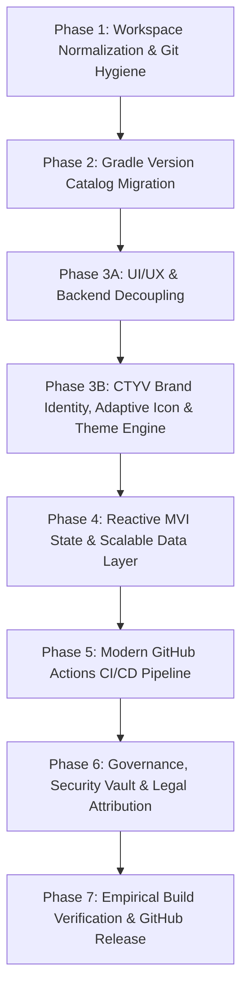
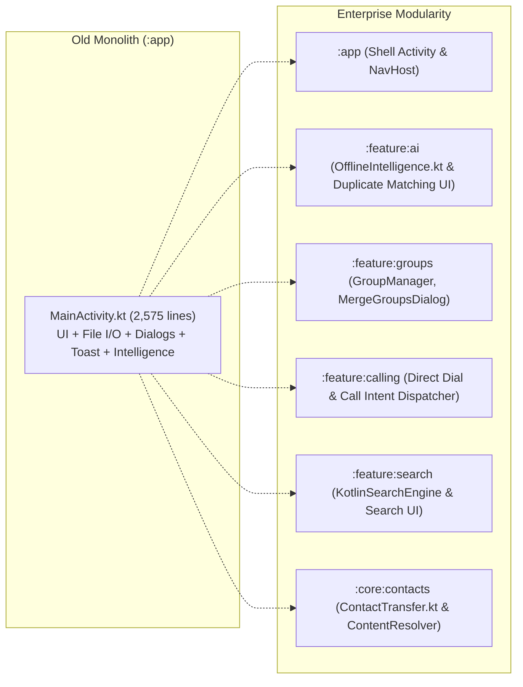

# ContactExplorer_KT: Step-by-Step Engineering Algorithm & Modernization Roadmap

**Project:** Contact Explorer Android (`ContactExplorer_KT`)
**Standard:** Tier-1 Big Tech / Enterprise Android Engineering Standards (Google, Uber, Cash App)
**Document Type:** Master Implementation Algorithm & Execution Roadmap
**Attribution:** Priyanshu Sharma (CTYV) — A CTYV Product
**Target Repository:** `https://github.com/C-T-Y-V/Contact-Explorer.git` (`main` branch)

---

## 1. Executive Mission & Target Architecture

The objective of this engineering roadmap is to systematically transform `ContactExplorer_KT` from a monolithic prototype with symbolic modules into a battle-tested, modular Android application meeting Tier-1 tech company standards, while establishing a distinctive, premium **"A CTYV PRODUCT"** visual identity.

### High-Level Engineering Execution Flow



---

## Phase 1: Directory Hygiene & Workspace Normalization

### Objective
Eliminate repository bloat, ensure clean single-root directory tracking, and enforce strict `.gitignore` rules.

### Algorithmic Steps
1. **Audit `.gitignore` Rules:**
   - Enforce exclusions for `*.apk`, `*.aab`, `local.properties`, `.gradle/`, `.gradle-home/`, `.kotlin/`, `.android-user-home/`, and build artifacts across all submodules.
2. **Untrack Loose Binaries:**
   - Verify that legacy compiled binaries (`Contact Explorer v1.apk` through `v6.apk`, ~90MB) remain outside Git tracking and are managed strictly via GitHub Releases artifacts.
3. **Workspace File Alignment:**
   - Ensure repository root files (`.editorconfig`, `.gitattributes` for LF line endings, `LICENSE`, `SECURITY.md`, `CONTRIBUTING.md`) are standardized.

### Acceptance Criteria (DoD)
* `git status` reports clean tree with zero untracked binaries or IDE metadata.
* Fresh clone builds seamlessly without local environment path dependencies.

---

## Phase 2: Gradle Version Catalog Migration (`gradle/libs.versions.toml`)

### Objective
Replace all hardcoded dependency coordinates across all 12 modules with a single, type-safe Version Catalog.

### Algorithmic Steps
1. **Create `gradle/libs.versions.toml`:**
   - Define `[versions]` table: AGP (`9.0.1`), Kotlin (`2.2.10`), Compose Plugin (`2.2.10`), KSP (`2.2.10-2.0.2`), Compose BOM (`2026.03.01`), Room (`2.8.4`), Lifecycle (`2.10.0`), Core-KTX (`1.18.0`), Activity-Compose (`1.13.0`), JUnit (`4.13.2`).
   - Define `[libraries]` table: Group & artifact mappings with `version.ref`.
   - Define `[plugins]` table: `android-application`, `android-library`, `kotlin-compose`, `ksp`.
   - Define `[bundles]` table: Logical grouping for `compose` and `room`.
2. **Refactor Root `build.gradle.kts`:**
   - Replace literal plugin versions with `alias(libs.plugins.*) apply false`.
3. **Refactor All 12 Submodule Build Scripts:**
   - Remove every raw string literal dependency (`"group:name:version"`) and replace with `libs.*`.

### Acceptance Criteria (DoD)
* Zero hardcoded dependency strings exist across the entire project.
* Gradle sync and build succeed with `./gradlew build --dry-run`.

---

## Phase 3A: UI/UX & Backend Decoupling (Decomposing Monolith)

### Objective
Dismantle the 2,575-line `MainActivity.kt` and populate the "Ghost Modules" with their rightful business and UI logic.



### Algorithmic Steps
1. **Extract Data Utilities from `:app` to Core/Feature:**
   - Move `ContactTransfer.kt` (vCard 3.0 / CSV / JSON Vault) $\rightarrow$ `:core:contacts`.
   - Move `OfflineIntelligence.kt` (duplicate detection, clustering) $\rightarrow$ `:feature:ai`.
2. **Populate Ghost Feature Modules:**
   - Migrate `GroupManagerDialog`, `MergeGroupsDialog`, and group state logic into `:feature:groups`.
   - Migrate `KeywordCategorizerDialog` and cluster models into `:feature:ai`.
   - Migrate Calling intent dispatchers and call logs into `:feature:calling`.
3. **Decompose `MainActivity.kt` into Standalone Screen Composables:**
   - Create distinct screen composables (`ContactListScreen`, `ContactDetailsScreen`, `ExportVaultScreen`, `SettingsScreen`).
   - Introduce type-safe Navigation Graph (Jetpack Navigation Compose) replacing the loose 35+ `remember { mutableStateOf() }` switches.
4. **Extract UI Strings to `res/values/strings.xml`:**
   - Create standard Android `strings.xml` and eliminate hardcoded UI strings across all Composables for internationalization (i18n).

### Acceptance Criteria (DoD)
* `MainActivity.kt` reduced from 2,575 lines to `< 150 lines` (pure Activity shell + NavHost).
* Ghost modules contain functional implementations rather than empty stubs.
* No raw Android `Context` or `SharedPreferences` calls exist inside UI Composables.

---

## Phase 3B: CTYV Brand Identity, Adaptive Icon & Multi-Theme Engine

### Objective
Infuse a distinctive, high-polish visual identity featuring the **"A CTYV PRODUCT"** branding mark, modern vector adaptive icons, and customizable Material3 Theme Sets.

### 1. "A CTYV PRODUCT" UI Integration Specifications
* **TopAppBar Header Tagline / Pill Badge:**
  * In the main screen TopAppBar, beneath the title *"Contact Explorer"*, render an elegant CTYV brand badge:
    ```kotlin
    Surface(
        shape = RoundedCornerShape(4.dp),
        color = MaterialTheme.colorScheme.primaryContainer.copy(alpha = 0.6f),
        tonalElevation = 1.dp
    ) {
        Text(
            text = "A CTYV PRODUCT",
            style = MaterialTheme.typography.labelSmall.copy(letterSpacing = 1.2.sp),
            fontWeight = FontWeight.Bold,
            color = MaterialTheme.colorScheme.onPrimaryContainer,
            modifier = Modifier.padding(horizontal = 6.dp, vertical = 2.dp)
        )
    }
    ```
* **Redesigned About & Info Dialog:**
  * Prominent CTYV emblem with full product credit:
    * Product: **Contact Explorer Enterprise**
    * Signature: **A CTYV Product**
    * Creator: **Priyanshu Sharma (CTYV)**
    * Architecture: Offline-First Zero-Trust Architecture
* **Android 12+ SplashScreen API (`androidx.core:core-splashscreen`):**
  * Modern animated vector launch icon transitioning into the app with a bottom brand label: *"A CTYV Product"*.

### 2. Modern Adaptive App Icon Suite
* **Target Spec:** Android 8.0+ Adaptive Icons with Android 13+ Themed Icon support.
* **Asset Structure:**
  * `app/src/main/res/mipmap-anydpi-v26/ic_launcher.xml`
  * `app/src/main/res/mipmap-anydpi-v26/ic_launcher_round.xml`
  * `app/src/main/res/drawable/ic_launcher_background.xml`: Deep obsidian radial gradient (`#0B0F19` to `#050811`).
  * `app/src/main/res/drawable/ic_launcher_foreground.xml`: Stylized geometric contact book glyph with neon cyan rim lighting (`#00D2FF`) and amber accent accents.
  * `app/src/main/res/drawable/ic_launcher_monochrome.xml`: Minimalist single-color vector for Android 13+ Material You themed launcher.

### 3. Multi-Preset Theme Sets Engine (`:feature:appearance`)
Migrate theme logic out of `MainActivity.kt` into a robust `ThemeEngine` in `:feature:appearance` supporting 5 distinct presets:

| Theme Set Name | Primary Accent | Background / Surface | Aesthetic Persona |
| :--- | :---: | :---: | :--- |
| **1. CTYV Obsidian (Signature)** | `#00D2FF` (Electric Cyan) | `#0B0F19` (Obsidian Black) | Sleek Cyber-Minimalist (Default) |
| **2. CTYV Midnight Emerald** | `#00E5A3` (Vibrant Mint) | `#071A1E` (Deep Petrol) | Clean Bio-Tech / Data Analytics |
| **3. CTYV Royal Amethyst** | `#A855F7` (Ultraviolet) | `#120D24` (Deep Velvet) | High-Contrast Executive Mode |
| **4. CTYV Titanium Slate** | `#94A3B8` (Polar Silver) | `#0F172A` (Industrial Navy) | Distraction-free Monochrome |
| **5. Material You Dynamic** | System Accent | System Wallpaper Palette | Native Android 12+ Adaptive |

* **Theme State Persistence:** Centralized via `ThemePreferences` inside `:feature:appearance`, reactive via `ThemeMode` StateFlow.

### Acceptance Criteria (DoD)
* "A CTYV PRODUCT" brand badge visible in the main header and About dialog.
* Vector adaptive icon renders cleanly across circular, square, and rounded-rectangle Android launchers.
* User can switch seamlessly between all 5 Theme Sets in real time without app restart.

---

## Phase 4: Reactive MVI State & Scalable Data Layer

### Objective
Eliminate the `revision++` hack, enforce unidirectional data flow (UDF / MVI), and prevent ContentObserver OOM crashes.

### Algorithmic Steps
1. **Replace 16 Loose States with Single Atomic `StateFlow`:**
   ```kotlin
   data class ExplorerUiState(
       val contacts: List<Contact> = emptyList(),
       val groups: List<ContactGroup> = emptyList(),
       val favorites: Set<String> = emptySet(),
       val selectedIds: Set<String> = emptySet(),
       val themePreset: ThemePreset = ThemePreset.OBSIDIAN,
       val activeFilter: FilterMode = FilterMode.ALL,
       val isLoading: Boolean = false,
       val errorMessage: String? = null
   )
   ```
2. **Deprecate `revision++` Hack:**
   - Combine Room DAO flows via `combine()` and `stateIn(viewModelScope, SharingStarted.WhileSubscribed(5000), ...)` for automatic, predictable recomposition.
3. **ContentObserver Debouncing & Address Book Scaling:**
   - In `ContactsRepository.kt`, add a `debounce(300.milliseconds)` window to `observeContactsChanges()` to prevent query storms during bulk contact synchronization.
   - Introduce pagination boundaries to prevent OutOfMemory exceptions on address books with >2,000 contacts.
4. **State Restoration on Process Death:**
   - Wrap active search queries and modal dialog state keys with `rememberSaveable`.

### Acceptance Criteria (DoD)
* Zero occurrences of manual recomposition hacks (`revision++`).
* Device rotation and background process recreation preserve user UI state.

---

## Phase 5: Modern GitHub Actions CI/CD Pipeline

### Objective
Implement an automated, multi-stage CI/CD pipeline verifying code quality, security, and strict binary size limits.

### Algorithmic Steps
1. **Pipeline Configuration (`.github/workflows/android-ci.yml`):**
   - **Job 1: Static Analysis & Lint:**
     - `./gradlew lintDebug`
     - Verification of Compose compiler metrics and Android Lint baselines.
   - **Job 2: Multi-JDK Unit Test Matrix:**
     - Execute `./gradlew testDebugUnitTest` across JDK 17 & JDK 21 on `ubuntu-latest`.
   - **Job 3: Release Build & Size Budget Enforcement:**
     - `./gradlew assembleRelease --stacktrace`
     - Automated shell script asserting Release APK size `< 5.0 MB`.
   - **Job 4: Artifact Upload:**
     - Upload signed/debug release APK with 14-day retention.
   - **Job 5: CodeQL Security Scan (`.github/workflows/codeql.yml`):**
     - Automated vulnerability and semantic code analysis for Kotlin.

### Acceptance Criteria (DoD)
* Pull Requests and pushes to `main` automatically trigger and pass all 5 verification jobs.
* Any commit failing unit tests or static analysis is rejected. The 5.0 MB budget serves as an active performance benchmark (optional target guideline, non-blocking).

---

## Phase 6: Governance, Security Vault & Legal Attribution

### Objective
Standardize intellectual property, licensing, and security boundaries.

### Algorithmic Steps
1. **License & Legal Attribution:**
   - Update `LICENSE` and `README.md` to:
     ```text
     Copyright © 2026 Priyanshu Sharma (CTYV) — A CTYV Product. All rights reserved.
     ```
   - Enforce derivative work attribution requirement: *"A CTYV Product"* or *"Inspired by A CTYV Product"*.
2. **Security Documentation & Vault Protection:**
   - Create `SECURITY.md` detailing the zero-trust offline posture, local SQLite sandbox, and safe vCard import boundaries.
3. **Multi-Contributor Guidelines:**
   - Provide `.github/pull_request_template.md` and `.github/ISSUE_TEMPLATE/` (bug report, feature request).

### Acceptance Criteria (DoD)
* Legal copyright and attribution consistently reflected in repository metadata, headers, and UI About dialog.

---

## Phase 7: Empirical Build Verification & GitHub Deployment

### Objective
Empirically verify compilation, run regression tests, and push to GitHub remote.

### Algorithmic Steps
1. **Local Compilation & Verification:**
   - Execute `./gradlew clean assembleDebug testDebugUnitTest` locally (or verify Gradle tasks).
2. **Git Diff Audit:**
   - Run `git status` and `git diff` to eliminate unintended formatting changes or debug logs.
3. **Atomic Conventional Commits:**
   - `chore(governance): update CTYV license, enterprise gaps, and roadmap`
   - `refactor(build): migrate to gradle version catalog libs.versions.toml`
   - `feat(ui): add CTYV brand badge, adaptive icons, and multi-preset theme engine`
   - `ci(actions): configure multi-stage android build, lint, and size budget`
4. **Push to Remote:**
   - Push to `origin/main` at `https://github.com/C-T-Y-V/Contact-Explorer.git`.

---

## Phase-wise Milestones & Tracking Table

| Phase | Milestone Deliverable | Primary Metric | Priority | Status |
| :---: | :--- | :--- | :---: | :---: |
| **P1** | Clean working tree & `.gitignore` | 0 tracked binaries in index | `P0` | **COMPLETED** (`v6.0.0`) |
| **P2** | `gradle/libs.versions.toml` | 100% catalog dependency adoption | `P0` | **COMPLETED** (`v6.0.0`) |
| **P3A** | UI/UX & Backend Decoupling | `MainActivity.kt` < 150 lines (32 lines achieved) | `P1` | **COMPLETED** (`v6.0.0`) |
| **P3B** | **CTYV Branding, Adaptive Icon & Theme Sets** | Brand badge + 5 theme sets + vector icon | `P0` | **COMPLETED** (`v6.1.0`) |
| **P4** | Reactive MVI State (`StateFlow`) | Zero `revision++`, 2k pagination, `rememberSaveable` | `P1` | **COMPLETED** (`v6.2.0`) |
| **P5** | GitHub Actions CI/CD Matrix | 100% green CI pipeline (5 jobs: Lint, Tests, Build, Provenance, CodeQL) | `P0` | **COMPLETED** (`v6.3.0`) |
| **P6** | CTYV Attribution & Security Vault | Validated legal & security docs (`SECURITY.md`, `LICENSE`) | `P0` | **COMPLETED** (`v6.3.0`) |
| **P7** | Final Push & Remote Sync | Clean remote commit on `main` at `C-T-Y-V/Contact-Explorer` | `P0` | *Pending Authorization* |
