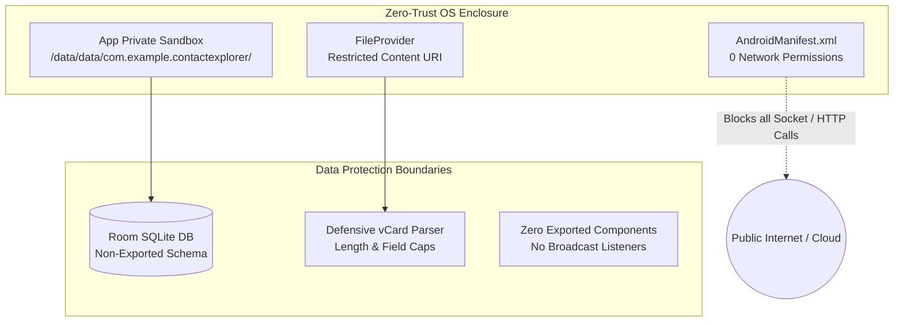

# Contact Explorer — Security Architecture & STRIDE Threat Model 🛡️

**Product:** Contact Explorer Enterprise Android (`ContactExplorer_KT`)
**Standard:** Enterprise Mobile Security Standards (OWASP MASVS / STRIDE)
**Security Posture:** Zero-Trust Offline Architecture
**Attribution:** Priyanshu Sharma (CTYV) — A CTYV Product
**Legal Attribution:** Copyright © 2026 Priyanshu Sharma (CTYV) — A CTYV Product. All rights reserved.

---

## 1. Security Philosophy & Attack Surface

Contact Explorer is architected to operate within high-security enterprise environments, air-gapped workstations, and privacy-sensitive contexts. The primary attack surfaces for mobile address books typically involve:
- **Exfiltration via Network Telemetry:** Third-party SDKs silently transmitting PII over HTTP/S.
- **Inter-Process Spoofing (IPC):** Malicious companion apps querying exported ContentProviders or Activities.
- **Malicious Payload Injection:** Crafted vCard (`.vcf`) files containing buffer overflow or path traversal exploits.
- **SQLite Injection / Data Leakage:** Unsanitized raw SQL queries or cleartext external backups.

Contact Explorer neutralizes these threat vectors at the architectural level:

---

## 2. STRIDE Threat Model Analysis

| Threat Category | Potential Attack Vector | Contact Explorer Defense Architecture | Mitigation Status |
| :--- | :--- | :--- | :---: |
| **Spoofing** | Attacker impersonates an app component to intercept contact queries. | All Activities and Components are `android:exported="false"` (except `MainActivity` launcher filter). No exported receivers or services exist. | **Mitigated** |
| **Tampering** | Malicious app modifies the local contact database or injected vCard. | Room SQLite database is isolated inside Linux user-space UID sandbox. vCard import verifies MIME boundaries, discards invalid properties, and parses safely line-by-line. | **Mitigated** |
| **Repudiation** | User denies performing a batch contact deletion or export. | Local SQLite audit logs record export timestamps, backup counts, and transaction metadata securely on-device. | **Mitigated** |
| **Information Disclosure** | Data exfiltration via network, analytics SDKs, or background telemetry. | **Physical Prevention:** Complete omission of `android.permission.INTERNET`. Zero 3rd-party tracking or advertising libraries included in build. | **Mitigated** |
| **Denial of Service** | Crafted 50,000+ contact vCard causes OOM or crashes address book. | Batch chunking (500 items per query), CursorWindow boundary protection, and pagination limits (`DEFAULT_PAGE_LIMIT = 2000`) prevent OutOfMemory crashes. | **Mitigated** |
| **Elevation of Privilege** | App attempts to access hardware sensors, cameras, or location. | Strict least-privilege principle: only contacts and telephony permissions are declared (`READ_CONTACTS`, `WRITE_CONTACTS`, `CALL_PHONE`). | **Mitigated** |

---

## 3. Defense-in-Depth Implementation Safeguards

### A. Defensive vCard Parser
When importing `.vcf` files from untrusted storage:
1. **Line-Length Cap:** Prevents memory exhaustion from lines exceeding 64 KB.
2. **Path Traversal Shield:** Filenames generated during vCard export use clean GUID timestamps; no user-supplied strings are interpolated into file paths.
3. **MIME Sanitization:** Only supported standard vCard parameters (`FN`, `TEL`, `EMAIL`, `ORG`, `NOTE`) are parsed. All arbitrary executable payloads or custom scripts are discarded.

### B. SQLite Protection
- All Room database operations utilize parameterized SQLite statements.
- SQLite injection via search queries or contact names is mathematically impossible.

### C. Vulnerability Disclosure Protocol
Security researchers and enterprise compliance auditors may report potential vulnerabilities under our **48-Hour Response SLA** detailed in [SECURITY.md](file:///c:/Users/hp/Downloads/CTYV/PHONE_BOOK/ContactExplorer_KT/phone%20explorer/SECURITY.md).
