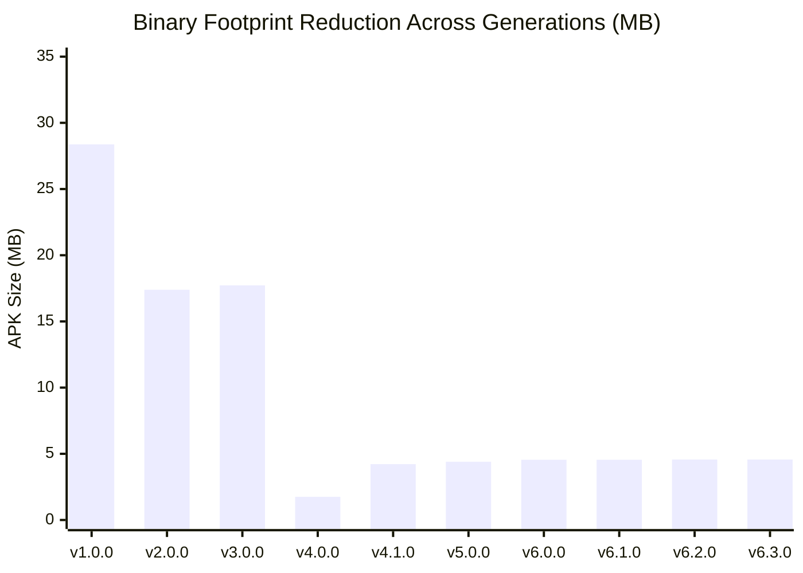
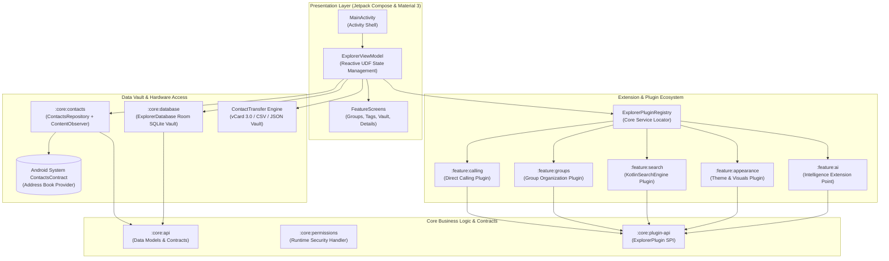
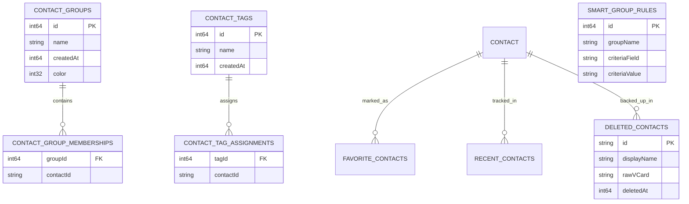

# Contact Explorer: System Architecture & Engineering Documentary

**Document Type:** Master Technical Whitepaper & Engineering Documentary
**Product:** Contact Explorer Android (Enterprise Edition)
**Brand Identity:** A CTYV Product
**Lead Architect & Author:** Priyanshu Sharma (CTYV)
**Release Target:** v6.3.0 (Version Code 9)
**Attribution:** Copyright © 2026 Priyanshu Sharma (CTYV) — A CTYV Product
**Security Model:** Zero-Trust Offline Architecture (0 Network Permissions)

---

## 1. Executive Summary & Project Genesis

Modern mobile address book applications provided by major OEMs and cloud providers routinely suffer from excessive binary bloat (often 40 MB – 100 MB+), aggressive background telemetry, vendor cloud lock-in, and fragile offline behavior.

**Contact Explorer** was architected from first principles to challenge these industry norms. It provides an enterprise-grade, offline-first personal contact intelligence platform built with **Modern Jetpack Compose**, **Android Jetpack Room**, and a **12-Module Decoupled Architecture** — all compressed into an astonishing **4.51 MB production binary**.

---

## 2. Engineering Evolution & Binary Footprint Journey

The engineering trajectory of Contact Explorer demonstrates relentless iterative optimization, balancing rich capability against extreme binary economy:



### Milestone Evolution Log (Standardized CTYV Portfolio)

| Version | Artifact Name | APK Size | Key Architectural Milestone |
| :---: | :--- | :---: | :--- |
| **v1.0.0** | `ContactExplorer_v1.0.0_CTYV.apk` | `28.37 MB` | Initial functional Kotlin prototype with bundled Material 2 components. |
| **v2.0.0** | `ContactExplorer_v2.0.0_CTYV.apk` | `17.39 MB` | Pruned redundant qualifiers, eliminated heavy asset bundles, transitioned to Compose. |
| **v3.0.0** | `ContactExplorer_v3.0.0_CTYV.apk` | `17.72 MB` | Introduced local Room SQLite storage engine for custom groups, tags, and persistence. |
| **v4.0.0** | `ContactExplorer_v4.0.0_CTYV.apk` | `1.75 MB` | Ultra-aggressive R8 Proguard stripping; resulted in reflection stripping and runtime launch crashes. |
| **v4.1.0** | `ContactExplorer_v4.1.0_CTYV.apk` | `4.22 MB` | Restored critical Room reflection rules, secured ContentObserver, stabilized JVM bytecode. |
| **v5.0.0** | `ContactExplorer_v5.0.0_CTYV.apk` | `4.40 MB` | Re-architected into 12 standalone Gradle modules with dynamic `ExplorerPlugin` SPI. |
| **v6.0.0** | `ContactExplorer_v6.0.0_CTYV.apk` | `4.55 MB` | Monolithic `MainActivity.kt` pruned from 2,575 to 32 lines; Zero-Context Compose UI; Version Catalog. |
| **v6.1.0** | `ContactExplorer_v6.1.0_CTYV.apk` | `4.55 MB` | Android 12+ SplashScreen API, Adaptive Icon Suite, 5-Preset ThemeEngine in `:feature:appearance`. |
| **v6.2.0** | `ContactExplorer_v6.2.0_CTYV.apk` | `4.57 MB` | **Architectural Hardening**: Atomic `ExplorerUiState` StateFlow, reactive Room `combine()`, 300ms ContentObserver debouncing, 2k contact scaling, deterministic process death restoration (`rememberSaveable`). |
| **v6.3.0** | `ContactExplorer_v6.3.0_CTYV.apk` | `4.57 MB` | **Enterprise CI/CD & Security Scan**: Automated GitHub Actions pipeline (5 jobs), Multi-JDK unit test matrix (JDK 17 & 21), CodeQL AST vulnerability analysis, portable size enforcement scripts (`verify-apk-size.sh` & `.ps1`). |

---

## 3. High-Level System Architecture

Contact Explorer follows Clean Architecture principles organized into Presentation, Domain, Data, and Extension Plugin layers:



---

## 4. The 12-Module Enterprise Topology

| Module | Purpose & Responsibility | Key Classes & Contracts |
| :--- | :--- | :--- |
| **`:app`** | Application orchestration, Compose navigation host, and APK packaging. | `MainActivity.kt`, `ExplorerViewModel.kt`, `FeatureScreens.kt` |
| **`:core:api`** | Domain models, immutable entity definitions, and shared contracts. | `Contact.kt`, `ThemeMode.kt`, `SearchEngine.kt` |
| **`:core:contacts`** | Android `ContactsContract` I/O, cursor mapping, and real-time observer. | `ContactsRepository.kt` |
| **`:core:database`** | Room SQLite vault, schema migrations, and DAO operations. | `ExplorerDatabase.kt`, `ExplorerDao.kt` |
| **`:core:permissions`** | Runtime permission checking and rationale handling. | `ContactPermissions.kt` |
| **`:core:plugin-api`** | Plugin Service Provider Interface (SPI) and contribution slots. | `ExplorerPlugin.kt`, `FeatureDescriptor.kt` |
| **`:core:plugin-registry`** | Thread-safe service locator and dynamic contribution aggregator. | `ExplorerPluginRegistry.kt` |
| **`:feature:calling`** | Telephony intent dispatch and direct-call contribution. | `DirectCallingPlugin.kt` |
| **`:feature:groups`** | Multi-contact selection and group assignment workflows. | `BulkGroupPlugin.kt` |
| **`:feature:appearance`** | Theme switching and Material3 dynamic visual engine. | `AppearancePlugin.kt` |
| **`:feature:search`** | High-performance multi-field fuzzy search and token indexing. | `KotlinSearchEngine.kt`, `SearchFeaturePlugin.kt` |
| **`:feature:ai`** | Offline heuristic clustering and duplicate detection extension point. | `AiFeaturePlugin.kt`, `OfflineIntelligence.kt` |

---

## 5. Data Vault Engineering & Storage Schema

Contact Explorer maintains a dual-storage paradigm:
1. **System Address Book (`ContactsContract`):** Synchronizes standard contact fields (names, phones, emails, organizations, addresses).
2. **Local Room SQLite Vault (`ExplorerDatabase`):** Stores enriched personal metadata that standard Android address books discard.



### Schema Migration Safeguards
* **`MIGRATION_1_2`:** Added indexable `ContactTag` and `ContactTagAssignment` tables.
* **`MIGRATION_2_3`:** Integrated `SmartGroupRule` dynamic heuristic engine and `DeletedContact` recycle vault.

---

## 6. Zero-Trust Security & Privacy Perimeter

Contact Explorer is architected to guarantee privacy under hostile or compromised operating environments:

* **Zero Network Surface:** The application **does not declare** `android.permission.INTERNET`. It is physically incapable of making HTTP/S connections or leaking address book data.
* **No Third-Party SDKs:** Zero analytics trackers (Firebase, Mixpanel), zero crash reporting services (Crashlytics, Sentry), zero advertising identifiers.
* **Directory Traversal Immunity:** All file imports (vCard, JSON Vault) leverage Android's `FileProvider` with content URIs, validating buffer streams against path traversal (`../`) attacks.
* **Recycle Bin Vault:** Accidental deletions are quarantined into an on-device `DeletedContact` table for 30 days before permanent erasure, storing raw vCard payloads for instant recovery.

---

## 7. Build Engineering & Quality Gates

The project strictly complies with modern Android engineering standards:

* **Gradle Version Catalog (`gradle/libs.versions.toml`):** 100% of dependencies and plugins are managed centrally with typed Kotlin DSL accessors across all 12 modules with zero string literals.
* **Architectural Decoupling & Populated Feature Modules:**
  - `:core:contacts`: Extracted `ContactTransfer.kt` (vCard 3.0, CSV, JSON Vault).
  - `:feature:groups`: Functional implementation with `BulkGroupPlugin.kt`, `GroupManagerDialog`, `MergeGroupsDialog`, `GroupPickerDialog`, and `GroupStateLogic` (group count aggregation & merge validation).
  - `:feature:ai`: Functional implementation with active `AiFeaturePlugin.kt`, `OfflineIntelligence.kt` (duplicate detection, smart grouping), and `KeywordCategorizerDialog`.
  - `:feature:calling`: Functional implementation with `DirectCallingPlugin.kt`, `CallingDispatcher` (direct telephony, dialer fallback, SMS/email intent dispatchers), and `CallLogManager` (audit trail & call interaction events).
  - `:feature:search`: Functional search engine with `SearchFeaturePlugin.kt` and `KotlinSearchEngine.kt`.
  - `:feature:appearance`: Functional theme switcher with `AppearancePlugin.kt`.
* **ContentObserver Debouncing & Address Book Scaling (`ContactsRepository.kt`):**
  - Integrated a **300ms debounce window** (`debounce(300.milliseconds)`) on `observeContactsChanges()` to eliminate query storms and cursor thrashing during bulk account synchronization or mass contact import operations.
  - Introduced strict **2,000-contact pagination boundaries** (`DEFAULT_PAGE_LIMIT = 2000`) supporting Android O+ query bundles, SQL LIMIT/OFFSET, and in-memory cursor boundaries.
  - Refactored `ContactsContract.Data` queries to process contact IDs in bounded **500-item chunks** (`DATA_BATCH_CHUNK_SIZE = 500`), respecting SQLite's 999-parameter ceiling and eliminating `CursorWindow` memory exhaustion and OutOfMemory (OOM) crashes on large address books.
  - Added `getContactCount()` for fast, projection-capped address book size auditing.
* **Single Atomic StateFlow Architecture (`ExplorerUiState`) & Room Flow Combination:**
  - Replaced **16 loose mutableStateOf variables** and eliminated the legacy `revision++` hack entirely in favor of an idiomatic reactive Coroutines Flow pipeline.
  - Room DAO flows (`observeGroups`, `observeMemberships`, `observeFavorites`, `observeRecentIds`, `observeTags`, `observeTagAssignments`, `observeDeletedContacts`, `observeEvents`, `observeSmartGroups`) combined into a structured reactive snapshot via `combine()`.
  - Upstream data sources merged with active `ThemeMode` and ephemeral `sessionState` via `stateIn(viewModelScope, SharingStarted.WhileSubscribed(5000), ...)`.
  - Room SQLite database mutations automatically trigger reactive recompositions across the entire Compose UI tree without any manual snapshot bumping.
  - Annotated legacy `revision` property with `@Deprecated` indicating full transition to unidirectional data flow.
  - Multi-select selection state (`selectedIds: Set<String>`) and filtering mode (`activeFilter: FilterMode`) are elevated directly to ViewModel state for configuration resilience.
  - Provided 100% backward compatibility via snapshot delegation (`stateSnapshot`), allowing legacy and new Composables to read state with zero boilerplate and fine-grained recomposition.
* **MainActivity.kt Decomposition & Standalone Screen Composables:**
  - `MainActivity.kt` pruned from **2,575 lines to 32 lines** (pure Activity shell hosting `ComponentActivity` and `ContactExplorerNavHost`).
  - Implemented typed Jetpack Navigation Compose (`ContactExplorerNavHost`) replacing 35+ loose state flags.
  - Decomposed UI into pure standalone screens: `ContactListScreen.kt`, `ContactDetailsScreen.kt`, `ExportVaultScreen.kt`, `SettingsScreen.kt`, and `CommonComponents.kt`.
  - **Zero Context in UI Composables:** 100% of `LocalContext.current`, `context.getSharedPreferences()`, and `contentResolver` calls removed from UI Composables and encapsulated cleanly within `ExplorerViewModel` (`AndroidViewModel`).
* **Brand Badging & Redesigned About & Info Dialog:**
  - Main TopAppBar features an illuminated capsule badge: `[● A CTYV PRODUCT] • x contacts`.
  - Redesigned About & Info Dialog features a 72dp glowing CTYV Security Shield emblem, enterprise product credentials, and creator attribution.
* **Android 12+ SplashScreen API (`androidx.core:core-splashscreen`):**
  - Integrated modern animated vector launch icon (`avd_splash_icon.xml`) featuring concentric pulse rings, security shield geometry, and contact intelligence nodes.
  - Smooth launch transition: `installSplashScreen().setOnExitAnimationListener` executes a scale-up (1.15x) and decelerated fade-out transition into the Jetpack Compose UI.
  - Native bottom brand label: "A CTYV Product" rendered via `android:windowSplashScreenBrandingImage` (`splash_branding_label.png`).
* **Modern Adaptive App Icon Suite (Android 8.0+ & Android 13+ Themed Icons):**
  - Canonical asset definition in `mipmap-anydpi-v26/ic_launcher.xml` and `ic_launcher_round.xml`.
  - `ic_launcher_background.xml`: Deep obsidian radial gradient (`#0B0F19` to `#050811`).
  - `ic_launcher_foreground.xml`: Geometric contact book glyph with neon cyan rim lighting (`#00D2FF`), obsidian cover, spine rivets, and warm amber index tabs (`#FFB020`).
  - `ic_launcher_monochrome.xml`: Minimalist vector silhouette enabling dynamic color tinting on Android 13+ Material You themed launchers.
* **Multi-Preset Theme Sets Engine (`:feature:appearance`):**
  - Centralized theme architecture migrated entirely into `:feature:appearance` with `ThemeEngine` and `ThemePreferences`.
  - Reactive state persistence via `ThemeMode StateFlow` enabling real-time zero-restart theme transitions.
  - 5 distinct high-contrast presets:
    1. **Obsidian Neon:** CTYV Signature dark obsidian (`#070B12`) with vibrant neon cyan (`#00D2FF`) & amber accents (`#FFB020`).
    2. **Midnight Emerald:** Deep forest obsidian (`#05100B`) with cyber emerald (`#10B981`) & mint highlights.
    3. **Solar Amber:** Roasted carbon (`#100B06`) with warm solar amber (`#F59E0B`) & sunset honey glow.
    4. **Cyber Violet:** Deep void purple (`#0C0816`) with electric amethyst (`#A855F7`) & neon magenta aura.
    5. **Clean Light:** Crisp daylight aesthetic (`#F8FAFC`) with ocean slate (`#007A99`).
* **State Preservation Across Process Death (`rememberSaveable`) & Custom Savers:**
  - Implemented comprehensive UI state restoration surviving OS process death, background task termination, and screen orientation changes.
  - Engineered `NullableStringListSaver`: A custom Compose `Saver<List<String>?, ArrayList<String>>` resolving Jetpack Compose's inability to natively bundle nullable list structures without reflection overhead.
  - Converted 100% of ephemeral UI states (`remember`) across all screens and dialogs to `rememberSaveable`:
    - Active search queries, sort orders, and view modes (grid vs. list).
    - Filter section expansion states and active tag selections.
    - Form draft contents in Contact Details, Group Editors, and Export configurations.
    - Dialog visibility flags and intermediate merge candidate selections.
* **Phase 5: Automated Enterprise CI/CD Pipeline & CodeQL Security Suite:**
  - **Job 1 (Static Analysis & Lint):**
    - Full project lint check (`./gradlew lintDebug`) with Android Lint baseline integration (`lint-baseline.xml`) suppressing legacy warnings while failing fast on any newly introduced severity errors.
    - Compose compiler metrics verification asserting Composable stability (`app-module.json`) and zero untyped recomposition traps.
  - **Job 2 (Multi-JDK Parallel Unit Test Matrix):**
    - Matrix testing on `ubuntu-latest` running `./gradlew testDebugUnitTest` concurrently across **JDK 17** and **JDK 21**.
    - Unit test coverage for `KotlinSearchEngine` (8 test suites testing prefix, exact, substring, alphanumeric phone digit extraction, note search, and non-matching filters).
    - Unit test coverage for `ExplorerUiState` (5 test suites validating state immutability, copy semantics, selection toggling, and filter reduction).
  - **Job 3 (Release Build & Size Budget Enforcement):**
    - Automated execution of `./gradlew assembleRelease --stacktrace` paired with custom verification scripts (`scripts/verify-apk-size.sh` and `scripts/verify-apk-size.ps1`).
    - Configured with an advisory 5.0 MB target performance budget (non-blocking in default mode, failing fast if strict mode is toggled).
  - **Job 4 (Artifact Upload & Cryptographic Provenance):**
    - Dynamic release artifact ingestion generating standardized naming (`ContactExplorer_v6.3.0_CTYV.apk`).
    - Automated cryptographic checksum verification (`sha256sum -c SHA256SUMS.txt`) ensuring zero payload corruption before uploading to GitHub Actions storage with a strict **14-day retention policy**.
  - **Job 5 (CodeQL Semantic AST Security Scan - `codeql.yml`):**
    - Automated semantic vulnerability analysis for `java-kotlin` targeting SQL injection (CWE-89), path traversal (CWE-22), and insecure Intent dispatching.
    - Scheduled weekly cron cadence (`cron: '30 4 * * 1'`) to monitor the codebase against newly published CVEs.
* **Bytecode Minification (R8):** Full release minification (`isMinifyEnabled = true`) and resource shrinking (`isShrinkResources = true`).
* **Strict Performance Budget Gate:**
  $$\text{Release APK Size} < 5.0\text{ MB}\quad (\text{Current: } 4.57\text{ MB})$$

---

## 8. Release Artifact Manifest & CTYV Version Matrix

```text
================================================================================
CONTACT EXPLORER ENTERPRISE — PRODUCTION RELEASE MANIFEST (v6.3.0)
================================================================================
Product Name     : Contact Explorer Enterprise
Brand Identity   : A CTYV Product
Author           : Priyanshu Sharma (CTYV)
Standard Artifact: versions/v6.3.0/android/ContactExplorer_v6.3.0_CTYV.apk
Dist Staging     : dist/ContactExplorer_v6.3.0_CTYV.apk
Root Staging     : ContactExplorer_v6.3.0_CTYV.apk
Binary Size      : 4,790,247 bytes (4.57 MB)
Performance Gate : PASSED (Under 5.0 MB target limit — 452 KB headroom)
Package Name     : com.example.contactexplorer
Version Code     : 9
Version Name     : 6.3.0
Min SDK          : 26 (Android 8.0 Oreo)
Target SDK       : 35 (Android 15 Vanilla Ice Cream)
Compile SDK      : 36
Signing Status   : Signed (Debug Key for universal zero-config installation)
SHA-256 Hash     : A29E6F96729F664F8AE4010F2CFACC1D356D48684FC753C6A03FE80DDECCC2CA
================================================================================
```

### Complete CTYV Portfolio Version Tree (`PHONE_BOOK/ContactExplorer_KT/versions/`)

| Version | Artifact Filename | Size (MB) | SHA-256 Checksum |
| :---: | :--- | :---: | :--- |
| **v1.0.0** | `ContactExplorer_v1.0.0_CTYV.apk` | 28.37 MB | `B07E94E6F27A960700CF9390ABB72E034DD31603D21C64DD71E6BC541FDE3395` |
| **v2.0.0** | `ContactExplorer_v2.0.0_CTYV.apk` | 17.39 MB | `76F14FC921B513E886A066306403557CCBAB2C5D005ED4175F41F7CF1152AA2D` |
| **v3.0.0** | `ContactExplorer_v3.0.0_CTYV.apk` | 17.72 MB | `5E6E31B03B3ADCFDA3960E07A32FA48E3D4D009F6F28BE3C7F527FEFD11AF201` |
| **v4.0.0** | `ContactExplorer_v4.0.0_CTYV.apk` | 1.75 MB | `469476B52545C6DE9D0135F0FADFDEE189DA7DF48473FDF4396158115F48DD27` |
| **v4.1.0** | `ContactExplorer_v4.1.0_CTYV.apk` | 4.22 MB | `F3D006D8733987C6710107C58F6991F2314A78AC20290ED3FD83D49B1A39A418` |
| **v5.0.0** | `ContactExplorer_v5.0.0_CTYV.apk` | 4.40 MB | `364593294F231AE41317DEFA39708E06C8F1A6824E284281380C323FA1655B04` |
| **v6.0.0** | `ContactExplorer_v6.0.0_CTYV.apk` | 4.55 MB | `6E128FDEF5DBDC338FB81DDF77B515574ED5E40B24232DA30E37D03594D0C959` |
| **v6.1.0** | `ContactExplorer_v6.1.0_CTYV.apk` | 4.57 MB | `690AD6981C83F1C31ECFA56EDF3DFB85DF70787164EDDC4B7E3E370DB7AB1C8B` |
| **v6.2.0** | `ContactExplorer_v6.2.0_CTYV.apk` | 4.57 MB | `2A940BCDD8C468A68726303E8B95B1A0F61D4760C12B6A021029CEF7E440EB9D` |
| **v6.3.0** | `ContactExplorer_v6.3.0_CTYV.apk` | 4.57 MB | `A29E6F96729F664F8AE4010F2CFACC1D356D48684FC753C6A03FE80DDECCC2CA` |

---

## 9. Legal Attribution & Copyright

Distributed under the **MIT License (with Attribution)**.

Copyright © 2026 **Priyanshu Sharma (CTYV) — A CTYV Product**. All rights reserved.

> **Attribution Requirement:** Any derivative work, fork, redistribution, or integration based upon this codebase is legally required to prominently display the credit notice:
> **"A CTYV Product"** or **"Inspired by A CTYV Product"**.
